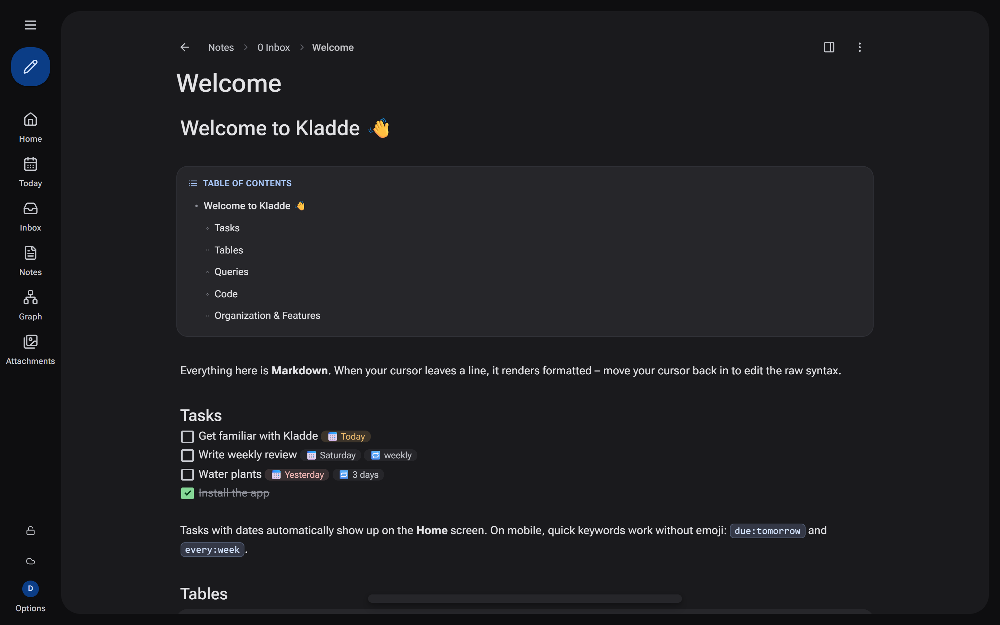
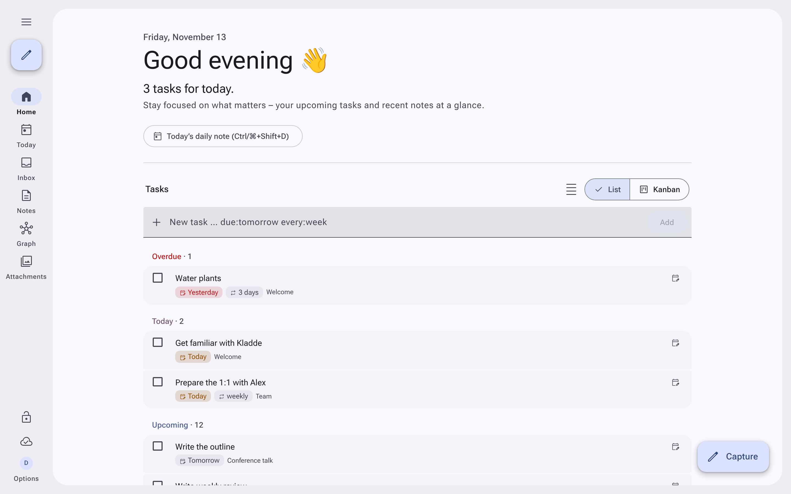
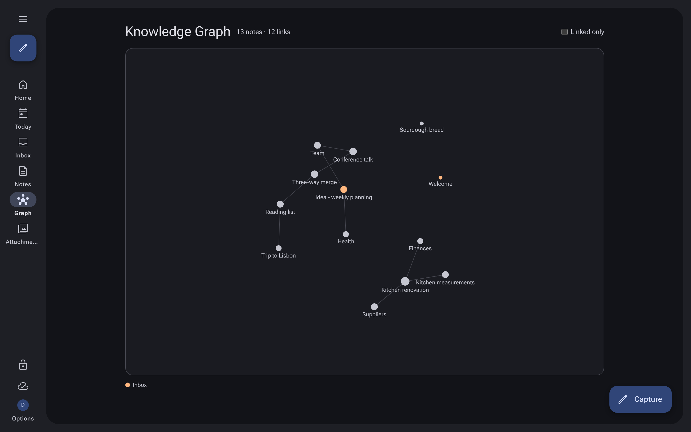
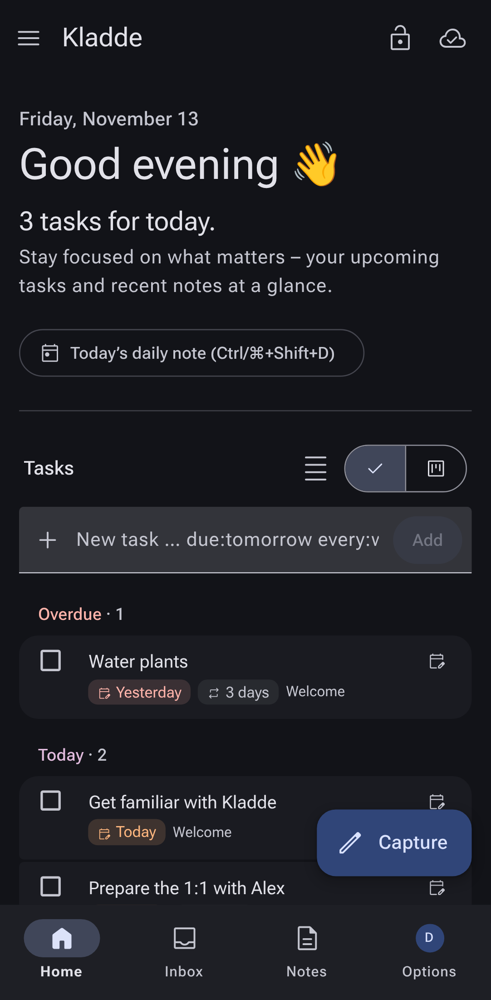
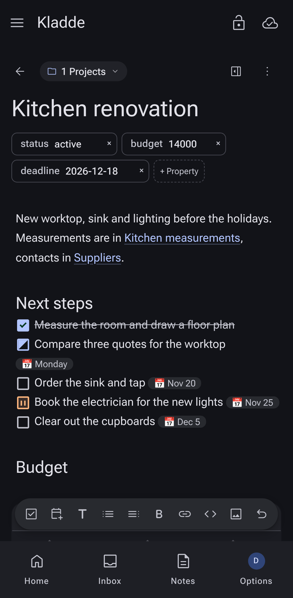

# Kladde

[English](README.md) · **Deutsch**

**Kladde** ist eine selbst gehostete Notiz-App für den Browser: Markdown mit Live-Vorschau, Aufgaben mit Fälligkeit und Wiederholung, Abfragen und Kanban-Boards über die eigenen Notizen – offline nutzbar auf Handy, iPad und Desktop, synchronisiert sobald wieder online. Zugang nur per Einladung, Anmeldung per **Passkey**, optional **mit GitLab** – oder mit Benutzername und Passwort, wo Passkeys nicht gehen (lokales Netz ohne HTTPS).



<table>
  <tr>
    <td width="50%"></td>
    <td width="50%"></td>
  </tr>
  <tr>
    <td align="center"></td>
    <td align="center"></td>
  </tr>
</table>

> Eine *Kladde* ist das Notizbuch, in das erst einmal alles hineinkommt, bevor es ins Reine geschrieben wird.

---

## ✨ Funktionen

| Bereich | Stand |
| --- | --- |
| **Zugang** | Einladungscode → Benutzername → Passkey oder Passwort. Optional „Mit GitLab anmelden“ (GitLab.com oder eigene Instanz, auf Gruppen beschränkbar). Weitere Geräte per Einmal-Code (15 min) oder zusätzlichem Passkey. Sessions als httpOnly-Cookie |
| **Verwaltung** | Für Admins in der App: Konten, Passwort-Reset, Gerätecodes, Admin-Rolle, Sperren, Einladungen, Protokoll. Das älteste Konto ist Admin |
| **Spaces** | Jeder Benutzer hat seinen eigenen Bereich, kein Zugriff auf fremde Notizen |
| **Teilen** | Pro Notiz oder **ganze Ordner** teilen (mit Rechten für Lesen, Bearbeiten, Anlegen, Löschen) oder öffentlicher Nur-Lese-Link für Gäste (`/s/…`) |
| **Editor** | CodeMirror 6 mit Live-Preview: Markdown-Syntax ist nur in der Cursor-Zeile sichtbar; **Slash-Befehle** (`/`) für Blöcke, Diagramme, Tabellen, Abfragen und Datei-Upload; Fußnoten (`[^1]`) |
| **Tabellen & Diagramme** | GFM-Tabellen als interaktive Tabellen (sortieren, filtern) und direkt in der Vorschau bearbeitbar: Zelle anklicken (Tab/Enter springt weiter), Spalten einfügen/umbenennen/entfernen, Zeilen hinzufügen/entfernen – in der Markdown-Ansicht bleibt es reiner Text; Mermaid-Diagramme (` ```mermaid `) und Mindmaps (` ```mindmap `) direkt in der Vorschau |
| **Abfragen & Kanban** | ```` ```query ```` -Blöcke: `TABLE`, `LIST`, `TASKS` sowie **`KANBAN`** (`KANBAN BY status VALUES "offen", "läuft", "fertig"`) mit interaktivem Drag-and-Drop |
| **Aufgaben** | `- [ ] Text 📅 2026-11-30 🔁 monatlich` oder handytauglich `due:morgen every:week`; freie Aufgaben auf der Startseite ohne Notiz; Schnellmenü für Fälligkeiten (Heute/Morgen/Woche); Doppelklick springt zur Quellnotiz |
| **PARA** | Ordner Inbox, Projekte, Bereiche, Ressourcen, Archiv. **Inbox als Arbeitsliste** (`/inbox`): jeder Gedanke ist eine eigene Notiz und wird per Klick zu Projekt, Bereich, Ressource, Zettel oder Archiv. **Projekte** mit `status: aktiv/pausiert/fertig`; „Abschließen“ setzt Status + Datum und verschiebt nach `4 Archiv/…`, „Wiederherstellen“ zurück. Ganze Ordner archivieren. Aktive Projekte auf dem Startbildschirm, mit Hinweis „kein nächster Schritt“ |
| **Zettelkasten** | Zettel-Dialog mit Typ (flüchtig, Literatur mit Quelle, dauerhaft) und fester ID im Frontmatter; `[[ID]]` und `[[ID Titel]]` bleiben auch nach Umbenennen gültig. Hinweis auf unverbundene Zettel |
| **Verknüpfen** | `[[Wikilinks]]` mit Autovervollständigung; **beim Umbenennen werden alle Links angepasst**; Rückverweise; **unverlinkte Erwähnungen** mit Knopf „Verlinken“; `#tags`; Frontmatter als Eigenschaften-Leiste |
| **Suche & Favoriten** | Suche in der Seitenleiste (`Strg/⌘+K`), mit Pfeiltasten durch die Treffer, Enter öffnet. Favoriten (Opt-In): Stern im Notizkopf oder `Strg/⌘+D`, einklappbare Liste „Favoriten“ in der Seitenleiste (nur sichtbar, wenn es Favoriten gibt) |
| **Wissensnetz** | Graph aller Notizen (`/graph`, nach PARA-Rolle eingefärbt, zoom- und verschiebbar) und lokales Netz unter jeder Notiz |
| **Versionsverlauf** | Verlauf pro Notiz mit bis zu 100 Ständen auf dem Server; Diff-Ansicht mit hinzugefügten/entfernten Zeilen (`git diff`-Stil) oder gerenderter Text; Wiederherstellung per Klick |
| **Rezept-Import** | Rezepte per Link importieren (schema.org von Chefkoch, EatSmarter, Food-Blogs etc.) einheitlich nach `3 Ressourcen/Rezepte`: Zutaten-Tabelle, nummerierte Schritte, Quelle |
| **KI & MCP** | MCP-Server (`/mcp`, Streamable HTTP) für Assistenten wie Claude Desktop, Claude Code, Cursor: OAuth 2.1 oder persönliche Zugriffstoken (PAT); Zugriff isoliert auf eigene Notizen |
| **Wochenrückblick** | Opt-In unter Einstellungen → Funktionen. `/review`: Inbox, überfällige Aufgaben, Projekte ohne nächsten Schritt, ruhende Bereiche, alte flüchtige und unverbundene Zettel; Erinnerung nach 7 Tagen |
| **Vorlagen** | Eigene Vorlagen unter Einstellungen → Vorlagen verwalten (`{{title}}`, `{{date}}`, `{{zid}}`), mit Standard-Zielordner und verschlüsselter Synchronisation |
| **Medien** | Bilder und PDFs per Einfügen/Ziehen/Button; Bilder-Grid mit ```` ```gallery ```` ; PDF eingebettet; Code-Blöcke mit Syntax-Highlighting und Kopieren |
| **Offline & Sync** | IndexedDB pro Konto, Sync über Cursor + Versionen; gleichzeitige Änderungen (anderes Gerät, andere Person, nachträglich synchronisierte Offline-Bearbeitung) werden per Drei-Wege-Merge zusammengeführt – zeilenweise, im selben Absatz wortweise; nur wenn beide dieselben Wörter ändern, bleibt der lokale Text als „(Konflikt …)“-Kopie erhalten; Live-Updates per Server-Sent Events |
| **Zusammenarbeit** | Gemeinsames Bearbeiten in Echtzeit (geteilte Notizen und eigene Geräte/Tabs): Änderungen erscheinen sofort im offenen Editor, ohne dass Cursor oder Rückgängig-Verlauf springen; im Notizkopf zeigen Profilbilder mit „Live“, wer die Notiz gerade offen hat (mit Geräteanzahl); im Editor steht an der Schreibstelle der anderen ein farbiger Cursor mit kleinem Profilbild, ihre Markierung ist eingefärbt |
| **App & Design** | PWA (installierbar, Service Worker), Designs Hell und Dunkel (Material 3 mit Navigation Rail am Desktop/Tablet und Navigation Bar am Handy); Notizlisten umschaltbar (Kacheln/Liste/Tabelle) |
| **Sicherheit** | Notizen (Pfad + Inhalt) und Anhänge AES-256-GCM-verschlüsselt auf dem Server, Origin-Prüfung, Rate-Limits, Audit-Log, gehärteter Container |
| **NAS** | Optionaler Klartext-Spiegel aller Notizen als `.md`-Dateien nach `EXPORT_DIR` (z. B. eingebundene NAS-Freigabe) |

### Noch nicht umgesetzt (Roadmap)
- Ende-zu-Ende-Verschlüsselung (Schlüssel nur im Browser) und Verschlüsselung der lokalen IndexedDB
- Anhänge offline hochladen (derzeit nur online)

---

## 🚀 Lokale Entwicklung

Voraussetzungen: Node.js ≥ 22.13 (für `node:sqlite`), npm ≥ 9.

```bash
npm install
npm run dev
```

- Frontend (Vite): http://localhost:5174 – leitet `/api` an den Server weiter
- Backend: http://localhost:3002
- **Dev-Login:** Auf der Anmeldeseite gibt es lokal den Button „Dev-Login“ (Benutzer `dev`, nur mit `DEV_LOGIN=1` und außerhalb von Production)
- Beim ersten Start schreibt der Server einen Einladungslink ins Log (`✉️ Erste Einladung …`). Passkeys funktionieren auf `localhost` auch ohne HTTPS
- Neu anfangen: `packages/server/data/` löschen

```bash
npm run build   # shared → server → client
npm run test    # Abfragesprache, Aufgaben, Notiz-/Benutzer-Store
npm run build:demo   # Demo nur im Browser, ohne Server → packages/client/dist-demo
```

**Demo:** `npm run build:demo` baut eine Version, die komplett im Browser läuft (kein Server, keine Synchronisation: die Notizen bleiben im Browser der Besucher; Teilen, Anhänge, Verlauf und KI-Zugriff sind aus). `.github/workflows/pages.yml` veröffentlicht sie bei jedem Push auf `main` auf GitHub Pages (einmalig *Settings → Pages → Source: GitHub Actions* einstellen). `DEMO_BASE` setzt den Unterpfad (Standard `/kladde-notes/`).

---

## 🖥️ Standalone Desktop-Modus (Einzeldatei / Windows `.exe`)

Kladde lässt sich ohne Docker und ohne Benutzerverwaltung als eigenständiges Desktop-Programm bauen (**Node.js SEA** + dediziertes Microsoft Edge `--app`-Fenster, alternativ Chrome oder Systembrowser):

```bash
git clone <repo> && cd kladde
npm install
npm run build:desktop   # natives Binary für das aktuelle OS (dist/kladde bzw. dist/kladde.exe)
npm run build:exe       # Windows-Executable dist/kladde.exe (unter macOS/Linux inkl. Download von node.exe)
```

- **Kein Login / keine Benutzerverwaltung:** Ein lokaler Einzelbenutzer (`lokal`) wird beim ersten Start automatisch angelegt; Einladungen, Passkeys, Admin-Bereich und Mehrbenutzer-/Link-Freigaben sind deaktiviert.
- **Lokale Speicherung (außerhalb der `.exe`):**
  - Windows: `%LOCALAPPDATA%\Kladde\` (`kladde.sqlite`, `secret.key`, `files\`, `backups\`, `kladde.log`)
  - macOS: `~/Library/Application Support/Kladde/` · Linux: `~/.local/share/kladde/`
  - **Portabler Modus:** Existiert neben `kladde.exe` ein Ordner `kladde-data` (oder wird `--portable-data` übergeben), landen alle Daten dort statt im Benutzerprofil.
- **Updates durch Austausch der `.exe`:** Alte `kladde.exe` schließen, neue `kladde.exe` drüberkopieren und starten. Bestehende verschlüsselte Notizen bleiben erhalten; vor Schema-Migrationen wird automatisch ein SQLite-Backup unter `backups\` angelegt.
- **Optionen:** `--data-dir=<pfad>`, `--portable-data`, `--port=<nr>` (Standard `34172`), `--server-only` (nur lokaler Server ohne Browserfenster).

---

## 🐳 Betrieb mit Docker

```bash
PUBLIC_URL=https://notes.example.org docker compose up --build -d
docker logs kladde   # enthält die erste Einladung
```

Die App läuft dann auf Port `13002`. **Passkeys brauchen HTTPS** (außer auf localhost) und sind an die Domain aus `PUBLIC_URL` gebunden – betreibe die App hinter einem Reverse-Proxy (Caddy, nginx, Traefik) und setze `TRUST_PROXY=1`. Ohne HTTPS (z. B. direkt über `http://192.168.1.10:13002` im Heimnetz) meldest du dich mit Benutzername und Passwort an.

CLI-Werkzeug (Import/Export, Suche, Anhänge, Sicherung & Verwaltung):

```bash
docker exec kladde node packages/server/dist/cli.js hilfe
docker exec kladde node packages/server/dist/cli.js import /import/ordner Projekte --overwrite
docker exec kladde node packages/server/dist/cli.js export / /export/space --with-files
docker exec kladde node packages/server/dist/cli.js einladen Anna
```

Ohne Zugriff auf den Server importierst du einen lokalen Ordner (z. B. einen Obsidian-Vault) mit der Import-CLI und einem Import-Token aus den Einstellungen: `npm run import -- <ordner> --url <Kladde-URL>`. Anleitung: [`docs/IMPORT.md`](docs/IMPORT.md).

| Variable | Bedeutung |
| --- | --- |
| `PUBLIC_URL` | Öffentliche Adresse; legt die Passkey-Domain fest und baut Einladungslinks |
| `TRUST_PROXY` | `1` hinter einem Reverse-Proxy |
| `DATA_KEY` | Schlüssel für die Verschlüsselung (`openssl rand -base64 32`). Leer = Schlüsseldatei `data/secret.key` im Volume |
| `SIGNUP_WITHOUT_INVITE` | Anmeldearten, mit denen neue Konten **ohne Einladung** entstehen: kommagetrennt `gitlab`, `passkey`, `password` oder `all`. Leer = jedes neue Konto braucht eine Einladung. Für Passkey/Passwort erscheint dann „Neues Konto erstellen“ auf der Anmeldeseite |
| `GITLAB_URL` | GitLab-Instanz für „Mit GitLab anmelden“ (Standard `https://gitlab.com`) |
| `GITLAB_INTERNAL_URL` | Optional: Adresse, unter der der Container GitLab erreicht, falls sie von `GITLAB_URL` abweicht (z. B. `http://192.168.1.20`) |
| `GITLAB_CLIENT_ID`, `GITLAB_CLIENT_SECRET` | OAuth-Anwendung aus GitLab; beide gesetzt = GitLab-Anmeldung an |
| `GITLAB_ALLOWED_GROUPS` | Nur Mitglieder dieser Gruppen (kommagetrennte Pfade, z. B. `familie,firma/team`; Untergruppen zählen mit), leer = alle |
| `GITLAB_ALLOW_SIGNUP` | Ältere Schreibweise für `SIGNUP_WITHOUT_INVITE=gitlab` (funktioniert weiter) |
| `GITLAB_LABEL` | Beschriftung des Knopfs, z. B. Name der eigenen Instanz (Standard `GitLab`) |
| `BACKUP_KEEP` | Tägliche Datenbank-Backups in `data/backups` (Standard 7, `0` = aus) |
| `TRASH_RETENTION_DAYS` | Tage, die gelöschte Notizen im Papierkorb bleiben, bevor sie endgültig gelöscht werden (Standard 30, `0` = bis zum manuellen Leeren) |
| `EXPORT_DIR` | Klartext-Spiegel der Notizen (z. B. NAS), leer = aus |

**Anmelden mit GitLab** (ausführliche Anleitung für selbst gehostete Instanzen, Netzwerk, eigene Zertifikate und Fehlersuche: [`docs/GITLAB.md`](docs/GITLAB.md)):

1. In GitLab eine OAuth-Anwendung anlegen: *Benutzereinstellungen → Anwendungen* (nur für dich) bzw. *Gruppe → Einstellungen → Anwendungen* oder *Admin → Anwendungen* (eigene Instanz).
   - **Redirect-URI:** `https://notes.example.org/api/auth/gitlab/callback` (also `PUBLIC_URL` + `/api/auth/gitlab/callback`)
   - **Vertraulich:** ja · **Bereiche (Scopes):** `openid` und `profile`
2. *Anwendungs-ID* und *Geheimnis* als Variablen setzen, z. B. in einer `.env` neben `docker-compose.yml`:

   ```env
   PUBLIC_URL=https://notes.example.org
   GITLAB_URL=https://gitlab.com            # oder https://gitlab.example.org
   GITLAB_CLIENT_ID=…
   GITLAB_CLIENT_SECRET=…
   GITLAB_ALLOWED_GROUPS=familie            # optional
   ```

3. `docker compose up -d` – auf der Anmeldeseite erscheint „Mit GitLab anmelden“.

Bestehende Konten verknüpfen GitLab unter *Einstellungen → Anmelden mit GitLab*; danach reicht der GitLab-Knopf. Neue Personen registrieren sich über ihren Einladungslink mit „Mit GitLab registrieren“ (Benutzername = GitLab-Name) – oder ohne Einladung, wenn `SIGNUP_WITHOUT_INVITE` `gitlab` enthält. Gesperrte Konten bleiben gesperrt; eine Verknüpfung lässt sich nur entfernen, solange ein Passkey oder Passwort bleibt.

**KI-Assistenten (MCP):** Unter `PUBLIC_URL/mcp` läuft ein MCP-Server (Streamable HTTP). Clients wie claude.ai, Claude Desktop oder Claude Code melden sich per OAuth 2.1 an (dynamische Registrierung, PKCE, Zustimmung mit dem normalen Kladde-Login) oder mit einem Zugriffstoken aus Einstellungen → KI-Assistenten (`Authorization: Bearer kld_…`). Jede Verbindung sieht nur die eigenen Notizen ihres Kontos. Der Reverse-Proxy muss dafür neben der App auch `/mcp`, `/oauth/…` und `/.well-known/oauth-…` durchreichen (Standard, wenn alles an Kladde geht); `PUBLIC_URL` sollte gesetzt sein, damit die OAuth-Adressen stimmen.

```bash
claude mcp add --transport http kladde https://notes.example.org/mcp
```

**Zur Verschlüsselung:** Liegt der Schlüssel im selben Volume wie die Datenbank, schützt das Kopien der Datenbank und Backups (NAS, Git), nicht einen vollständig übernommenen Server. Für mehr Schutz `DATA_KEY` als Secret übergeben. Den Schlüssel unbedingt sichern – ohne ihn sind die Notizen verloren.

---

## 📁 Projektstruktur

```
kladde/
├── packages/
│   ├── shared/   # Typen, Markdown-Metadaten, Aufgaben-Parser (Fälligkeit/Wiederholung), Abfragesprache
│   ├── server/   # Express + node:sqlite: Passkeys (SimpleWebAuthn), GitLab-OAuth, Sync, Freigaben, Dateien
│   └── client/   # React 18 + Vite + Tailwind + CodeMirror 6, IndexedDB-Sync, PWA
├── scripts/      # release.mjs, build-desktop.mjs, docker-entrypoint.sh
├── Dockerfile
└── docker-compose.yml
```

### Sync-Protokoll (Kurzfassung)
- `GET /api/sync?since=N` → alle eigenen und geteilten Notizen mit `seq > N`, entzogene Freigaben, neuer Cursor
- `POST /api/sync` mit `{ changes: [{ id, baseVersion, path, content, deleted }] }` → je Notiz `ok` (neue Version), `conflict` (Serverstand) oder `forbidden`
- `GET /api/events` (SSE) meldet `changed`, damit andere Geräte sofort nachladen

---

## 🤝 Mitmachen & Sicherheit

Beiträge sind willkommen, siehe [CONTRIBUTING.md](CONTRIBUTING.md) (englisch). Sicherheitslücken bitte vertraulich melden, wie in [SECURITY.md](SECURITY.md) beschrieben. Änderungen stehen im [CHANGELOG.md](CHANGELOG.md).

## 📄 Lizenz

[MIT](LICENSE) © Stefan Stumpf
