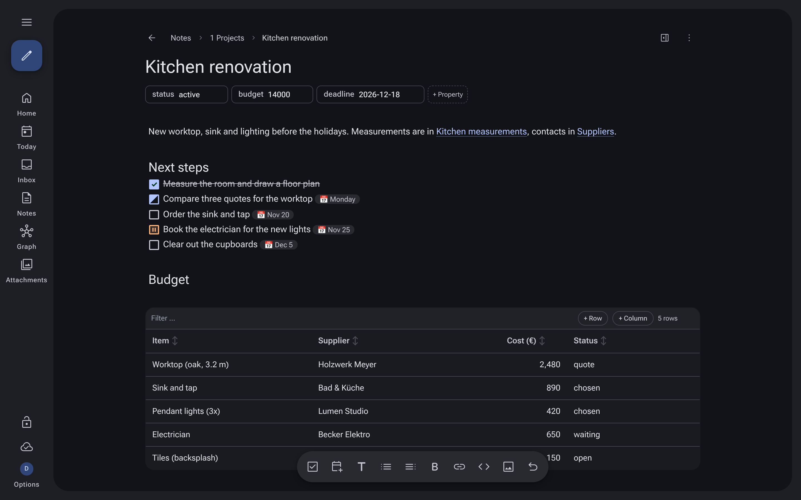
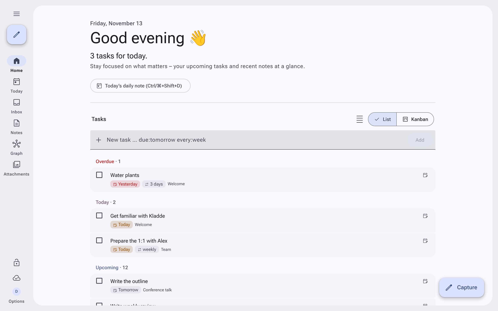
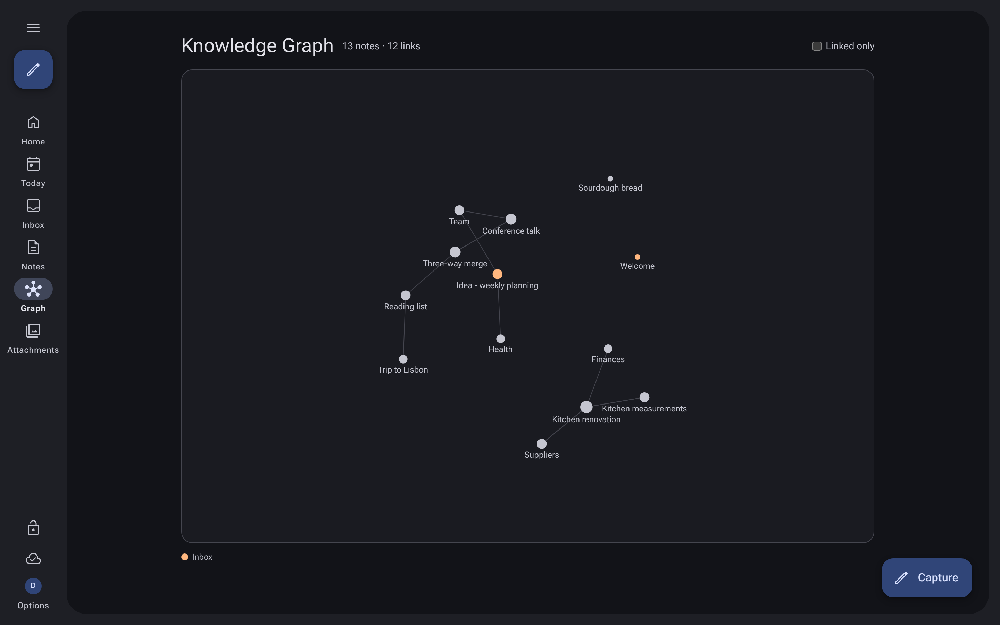
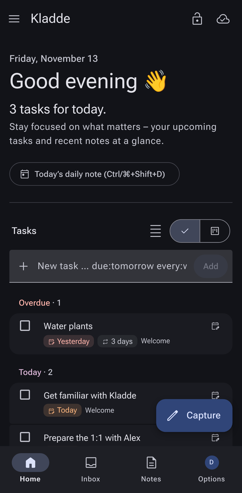
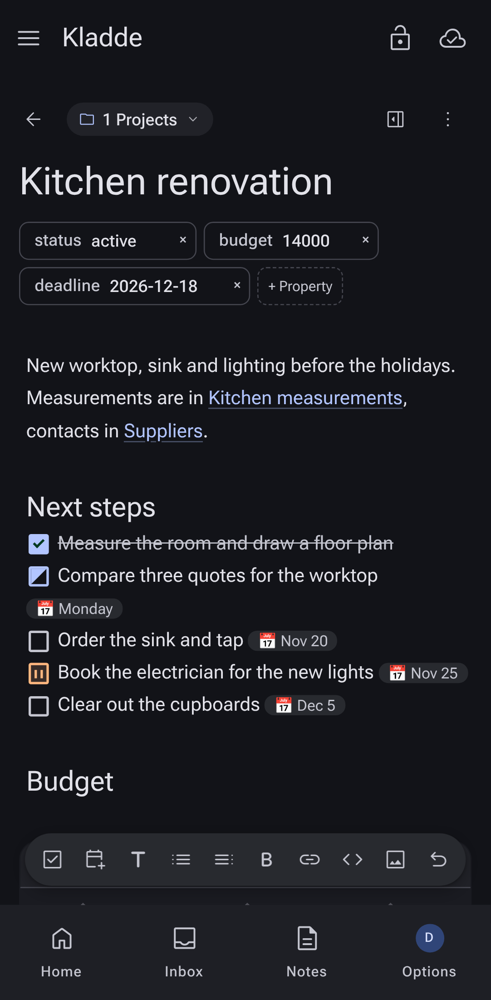

# Kladde

[English](README.md) · [Deutsch](README.de.md)

**Kladde** is a self-hosted notes app for the browser: Markdown with live preview, tasks with due dates and recurrence, queries and Kanban boards across your own notes. It works offline on phone, iPad and desktop and syncs as soon as you are back online. Access is by invitation only, with **passkeys**, optionally **GitLab sign-in**, or username and password where passkeys are not an option (local network without HTTPS).



<table>
  <tr>
    <td width="50%"></td>
    <td width="50%"></td>
  </tr>
  <tr>
    <td align="center"></td>
    <td align="center"></td>
  </tr>
</table>

> A *Kladde* (German) is the notebook where everything goes first, before it is written up properly.

The app and its UI are available in **English and German**. Some of the guides in `docs/` and a few CLI command names are still German.

---

## ✨ Features

| Area | What you get |
| --- | --- |
| **Access** | Invitation code → username → passkey or password. Optional "Sign in with GitLab" (GitLab.com or your own instance, restrictable to groups). More devices via a one-time code (15 min) or an additional passkey. Sessions as httpOnly cookie |
| **Administration** | In the app for admins: accounts, password reset, device codes, admin role, blocking, invitations, audit log. The oldest account is the admin |
| **Spaces** | Every user has their own space, no access to other people's notes |
| **Sharing** | Share single notes or **whole folders** (with rights to read, edit, create, delete), or a public read-only link for guests (`/s/…`) |
| **Editor** | CodeMirror 6 with live preview: Markdown syntax is only visible on the cursor line; **slash commands** (`/`) for blocks, diagrams, tables, queries and file upload; footnotes (`[^1]`) |
| **Tables & diagrams** | GFM tables as interactive tables (sort, filter) that can be edited right in the preview: click a cell (Tab/Enter moves on), insert/rename/remove columns, add/remove rows. In the Markdown view it stays plain text. Mermaid diagrams (` ```mermaid `) and mind maps (` ```mindmap `) rendered in place |
| **Queries & Kanban** | ```` ```query ```` blocks: `TABLE`, `LIST`, `TASKS` and **`KANBAN`** (`KANBAN BY status VALUES "open", "doing", "done"`) with interactive drag and drop |
| **Tasks** | `- [ ] Text 📅 2026-11-30 🔁 monthly`, or phone-friendly `due:tomorrow every:week`; statuses (open, in progress, blocked, done); free tasks on the home page without a note; quick menu for due dates (today/tomorrow/week); double-click jumps to the source note |
| **PARA** | Folders Inbox, Projects, Areas, Resources, Archive. **Inbox as a work list** (`/inbox`): every thought is its own note and becomes a project, area, resource, Zettel or archive item with one click. **Projects** with `status: active/paused/done`; "Complete" sets the status and date and moves the note to the archive, "Restore" moves it back. Archive whole folders. Active projects on the home screen, with a hint when there is no next step |
| **Zettelkasten** | Zettel dialog with type (fleeting, literature with source, permanent) and a fixed ID in the frontmatter; `[[ID]]` and `[[ID Title]]` stay valid after renaming. Hint for unconnected Zettel |
| **Linking** | `[[Wikilinks]]` with autocomplete; **all links are updated when you rename a note**; backlinks; **unlinked mentions** with a "Link" button; `#tags`; frontmatter as a properties bar |
| **Search & favorites** | Sidebar search (`Ctrl/⌘+K`), arrow keys through the results, Enter opens. Favorites (opt-in): star in the note header or `Ctrl/⌘+D`, collapsible list in the sidebar |
| **Knowledge graph** | Graph of all notes (`/graph`, colored by PARA role, zoomable and draggable) and a local graph below every note |
| **Version history** | History per note with up to 100 versions on the server; diff view with added/removed lines (`git diff` style) or rendered text; restore with a click |
| **Recipe import** | Import recipes by link (schema.org, e.g. from recipe sites and food blogs) into `3 Resources/Recipes`: ingredient table, numbered steps, source |
| **Git sync** | Push your own notes automatically as Markdown files to a personal Git repository (GitLab, GitHub, etc.) on branch `main`, with a customizable commit message |
| **AI & MCP** | MCP server (`/mcp`, Streamable HTTP) for assistants such as Claude Desktop, Claude Code, Cursor: OAuth 2.1 or personal access tokens; access limited to your own notes |
| **Weekly review** | Opt-in under Settings → Features. `/review`: inbox, overdue tasks, projects without a next step, dormant areas, old fleeting and unconnected Zettel; reminder after 7 days |
| **Templates** | Your own templates under Settings → Templates (`{{title}}`, `{{date}}`, `{{zid}}`), with a default target folder and encrypted sync |
| **Media** | Images and PDFs by paste, drag and drop or button; image grid with ```` ```gallery ```` and carousel with ```` ```carousel ````; embedded PDF viewer and PDF notes; code blocks with syntax highlighting and copy button |
| **Offline & sync** | IndexedDB per account, sync via cursor + versions; concurrent changes (another device, another person, offline edits synced later) are merged with a three-way merge, line by line and word by word within a paragraph; only if both change the same words, the local text is kept as a "(Conflict …)" copy; live updates via Server-Sent Events |
| **Collaboration** | Real-time co-editing (shared notes and your own devices/tabs): changes appear immediately in the open editor without cursor or undo history jumping; avatars with "Live" in the note header show who has the note open; colored remote cursors and selections in the editor |
| **App & design** | PWA (installable, service worker), Material 3 design in dark and light with a navigation rail on desktop/tablet and a navigation bar on phones; note lists switchable between tiles, list and table |
| **Security** | Notes (path + content) and attachments AES-256-GCM encrypted on the server, origin checks, rate limits, audit log, hardened container |
| **NAS** | Optional plain-text mirror of all notes as `.md` files to `EXPORT_DIR` (e.g. a mounted NAS share) |

### Not implemented yet (roadmap)
- End-to-end encryption (key only in the browser) and encryption of the local IndexedDB
- Uploading attachments offline (currently online only)

---

## 🚀 Local development

Requirements: Node.js ≥ 22.13 (for `node:sqlite`), npm ≥ 9.

```bash
npm install
npm run dev
```

- Frontend (Vite): http://localhost:5174, proxies `/api` to the server
- Backend: http://localhost:3002
- **Dev login:** locally the sign-in page has a "Dev login" button (user `dev`, only with `DEV_LOGIN=1` and outside production)
- On first start the server writes an invitation link to the log (`✉️ Erste Einladung …`). Passkeys work on `localhost` without HTTPS
- Start over: delete `packages/server/data/`

```bash
npm run build   # shared → server → client
npm run test    # query language, tasks, note/user store, sync, MCP, import, …
npm run lint
```

See [CONTRIBUTING.md](CONTRIBUTING.md) for how to contribute and [AGENTS.md](AGENTS.md) for the architecture and rules of the codebase.

---

## 🖥️ Standalone desktop mode (single file / Windows `.exe`)

Kladde can be built as a standalone desktop program without Docker and without user management (**Node.js SEA** + a dedicated Microsoft Edge `--app` window, alternatively Chrome or the system browser):

```bash
git clone https://github.com/steveee99/kladde-notes.git && cd kladde-notes
npm install
npm run build:desktop   # native binary for the current OS (dist/kladde or dist/kladde.exe)
npm run build:exe       # Windows executable dist/kladde.exe (on macOS/Linux including a download of node.exe)
```

- **No login / no user management:** a local single user (`lokal`) is created automatically on first start; invitations, passkeys, the admin area and multi-user/link sharing are disabled.
- **Local storage (outside the `.exe`):**
  - Windows: `%LOCALAPPDATA%\Kladde\` (`kladde.sqlite`, `secret.key`, `files\`, `backups\`, `kladde.log`)
  - macOS: `~/Library/Application Support/Kladde/` · Linux: `~/.local/share/kladde/`
  - **Portable mode:** if a folder `kladde-data` exists next to `kladde.exe` (or `--portable-data` is passed), all data goes there instead of the user profile.
- **Updates by replacing the `.exe`:** close the old `kladde.exe`, copy the new one over it and start it. Existing encrypted notes are kept; before schema migrations an SQLite backup is created automatically under `backups\`.
- **Options:** `--data-dir=<path>`, `--portable-data`, `--port=<n>` (default `34172`), `--server-only` (local server only, no browser window).

---

## 🐳 Running with Docker

```bash
git clone https://github.com/steveee99/kladde-notes.git && cd kladde-notes
PUBLIC_URL=https://notes.example.org docker compose up --build -d
docker logs kladde   # contains the first invitation
```

The app then runs on port `13002`. **Passkeys need HTTPS** (except on localhost) and are bound to the domain from `PUBLIC_URL`. Run the app behind a reverse proxy (Caddy, nginx, Traefik) and set `TRUST_PROXY=1`. Without HTTPS (e.g. directly via `http://192.168.1.10:13002` in your home network) you sign in with username and password.

CLI tool (import/export, search, attachments, backup and administration). The command names are German:

```bash
docker exec kladde node packages/server/dist/cli.js hilfe       # help
docker exec kladde node packages/server/dist/cli.js import /import/folder Projects --overwrite
docker exec kladde node packages/server/dist/cli.js export / /export/space --with-files
docker exec kladde node packages/server/dist/cli.js einladen Anna   # create an invitation
```

Without access to the server you can import a local folder (e.g. an Obsidian vault) with the import CLI and an import token from the settings: `npm run import -- <folder> --url <Kladde URL>`. Guide: [`docs/IMPORT.md`](docs/IMPORT.md) (German).

| Variable | Meaning |
| --- | --- |
| `PUBLIC_URL` | Public address; sets the passkey domain and builds invitation links |
| `TRUST_PROXY` | `1` behind a reverse proxy |
| `DATA_KEY` | Encryption key (`openssl rand -base64 32`). Empty = key file `data/secret.key` in the volume |
| `SIGNUP_WITHOUT_INVITE` | Sign-in methods that create new accounts **without an invitation**: comma-separated `gitlab`, `passkey`, `password` or `all`. Empty = every new account needs an invitation. For passkey/password the sign-in page then shows "Create new account" |
| `GITLAB_URL` | GitLab instance for "Sign in with GitLab" (default `https://gitlab.com`) |
| `GITLAB_INTERNAL_URL` | Optional: address the container uses to reach GitLab if it differs from `GITLAB_URL` (e.g. `http://192.168.1.20`) |
| `GITLAB_CLIENT_ID`, `GITLAB_CLIENT_SECRET` | OAuth application from GitLab; both set = GitLab sign-in enabled |
| `GITLAB_ALLOWED_GROUPS` | Only members of these groups (comma-separated paths, e.g. `family,company/team`; subgroups count), empty = everyone |
| `GITLAB_ALLOW_SIGNUP` | Older spelling of `SIGNUP_WITHOUT_INVITE=gitlab` (keeps working) |
| `GITLAB_LABEL` | Button label, e.g. the name of your own instance (default `GitLab`) |
| `BACKUP_KEEP` | Daily database backups in `data/backups` (default 7, `0` = off) |
| `EXPORT_DIR` | Plain-text mirror of the notes (e.g. NAS), empty = off |

**Sign in with GitLab** (detailed guide for self-hosted instances, networking, custom certificates and troubleshooting: [`docs/GITLAB.md`](docs/GITLAB.md), German):

1. Create an OAuth application in GitLab: *User settings → Applications* (just for you), or *Group → Settings → Applications*, or *Admin → Applications* (own instance).
   - **Redirect URI:** `https://notes.example.org/api/auth/gitlab/callback` (that is `PUBLIC_URL` + `/api/auth/gitlab/callback`)
   - **Confidential:** yes · **Scopes:** `openid` and `profile`
2. Set the *Application ID* and *Secret* as variables, e.g. in an `.env` next to `docker-compose.yml`:

   ```env
   PUBLIC_URL=https://notes.example.org
   GITLAB_URL=https://gitlab.com            # or https://gitlab.example.org
   GITLAB_CLIENT_ID=…
   GITLAB_CLIENT_SECRET=…
   GITLAB_ALLOWED_GROUPS=family             # optional
   ```

3. `docker compose up -d`. The sign-in page now shows "Sign in with GitLab".

Existing accounts link GitLab under *Settings → Sign in with GitLab*; after that the GitLab button is enough. New people register through their invitation link with "Register with GitLab" (username = GitLab name), or without an invitation if `SIGNUP_WITHOUT_INVITE` contains `gitlab`. Blocked accounts stay blocked; a link can only be removed while a passkey or password remains.

**AI assistants (MCP):** an MCP server (Streamable HTTP) runs at `PUBLIC_URL/mcp`. Clients such as claude.ai, Claude Desktop or Claude Code sign in via OAuth 2.1 (dynamic registration, PKCE, consent with the normal Kladde login) or with an access token from Settings → AI assistants (`Authorization: Bearer kld_…`). Every connection only sees the notes of its own account. The reverse proxy must forward `/mcp`, `/oauth/…` and `/.well-known/oauth-…` to the app (the default if everything goes to Kladde); `PUBLIC_URL` should be set so that the OAuth addresses are correct.

```bash
claude mcp add --transport http kladde https://notes.example.org/mcp
```

**About encryption:** if the key lives in the same volume as the database, it protects copies of the database and backups (NAS, Git), but not a fully compromised server. For more protection pass `DATA_KEY` as a secret. Back the key up: without it the notes are lost.

---

## 📁 Project structure

```
kladde/
├── packages/
│   ├── shared/   # types, Markdown metadata, task parser (due date/recurrence), query language
│   ├── server/   # Express + node:sqlite: passkeys (SimpleWebAuthn), GitLab OAuth, sync, sharing, files
│   └── client/   # React 18 + Vite + Tailwind + CodeMirror 6, IndexedDB sync, PWA
├── scripts/      # release.mjs, build-desktop.mjs, docker-entrypoint.sh
├── Dockerfile
└── docker-compose.yml
```

### Sync protocol (short version)
- `GET /api/sync?since=N` → all own and shared notes with `seq > N`, revoked shares, new cursor
- `POST /api/sync` with `{ changes: [{ id, baseVersion, path, content, deleted }] }` → per note `ok` (new version), `conflict` (server state) or `forbidden`
- `GET /api/events` (SSE) reports `changed` so that other devices reload immediately

---

## 🤝 Contributing & security

Contributions are welcome, see [CONTRIBUTING.md](CONTRIBUTING.md). Please report security issues privately as described in [SECURITY.md](SECURITY.md). Release notes are in [CHANGELOG.md](CHANGELOG.md).

## 📄 License

[MIT](LICENSE) © Stefan Stumpf
