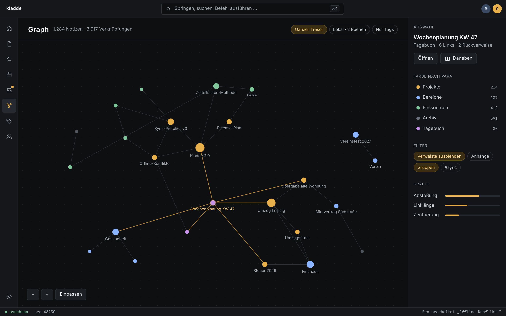
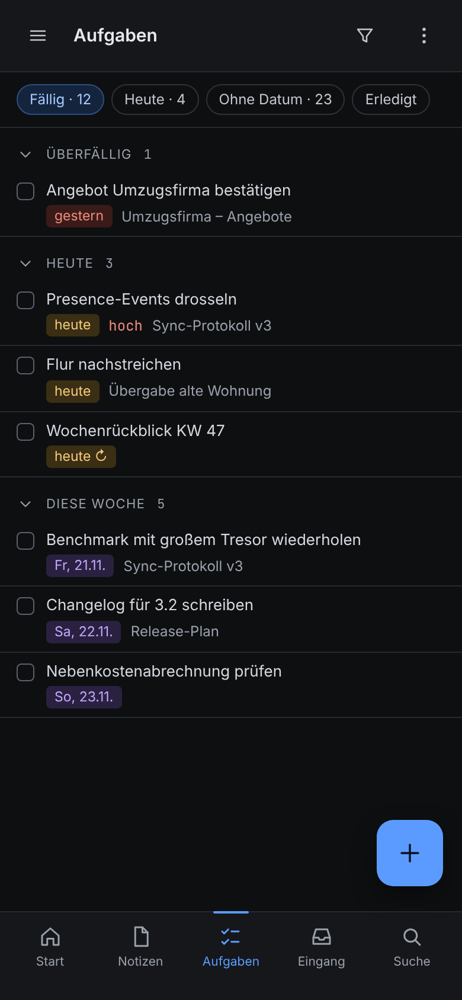
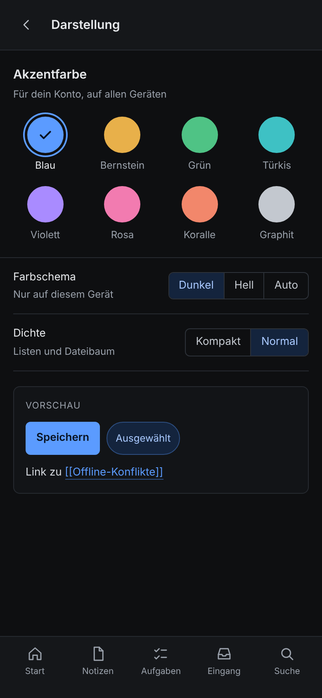

# Design: Werkbank

Werkbank ("workbench") is the design of Kladde. It replaced the Material 3 design.

**Status: in use since the release after 2.13.0.** The tokens, both color schemes, the accent colors, the
components and the shell are implemented; [Still to come](#still-to-come) lists what the mockups show beyond that.
Rule 4 in [CLAUDE.md](../CLAUDE.md) is the short version for contributors.


## Idea

Kladde is a tool for people with large vaults who write, link and plan every day. Werkbank treats it like that:

- **Dense, calm, dark.** Graphite surfaces, small type, thin lines instead of filled surfaces and shadows. Much of
  the vault fits on the screen at once.
- **One accent, chosen by each user.** The accent color marks what matters right now: the selection, the primary
  action, links, the user's own cursor. Everything else is grey. The default is blue; every user can pick another one
  (see [Accent color](#accent-color)).
- **Keyboard first.** ⌘K opens the command palette from everywhere; shortcuts are shown next to the commands
  (`<kbd>`), and every action has one.
- **State is visible.** A status bar shows sync, `seq`, word count and who else is working. Presence (avatars, remote
  cursors) appears where it happens.
- **Text is the product.** The editor gets a narrow, readable column (max. 760px) and the most contrast. Chrome steps
  back.

## Colors

The dark scheme is the default. All values are CSS variables in `client/src/index.css` (`:root`, light values in
`[data-theme='werkbank'][data-scheme='light']`) as `R G B` triplets; Tailwind classes use the same names (`bg-panel`,
`text-muted`, `bg-acc/20`). The Material 3 role names (`--surface-container-high`, `--primary`, …) remain as aliases
onto these tokens so older views keep working; new code uses the Werkbank names.

### Surfaces and lines

| Token        | Value     | Use                                                        |
| ------------ | --------- | ---------------------------------------------------------- |
| `--bg`       | `#0E0F11` | Page, editor, main content                                 |
| `--panel`    | `#121417` | Side panels (tree, inspector), cards                       |
| `--bar`      | `#15171A` | Top bar, rail, status bar, phone bars, dialogs             |
| `--raised`   | `#1C1F23` | Buttons, inline code, inputs on panels                     |
| `--line`     | `#262A30` | Dividers, card borders, selected row in a list             |
| `--line2`    | `#2D3239` | Borders of controls (buttons, chips, search field, `kbd`)  |

### Text

| Token      | Value     | Contrast on `--bg` | Use                                              |
| ---------- | --------- | ------------------ | ------------------------------------------------ |
| `--strong` | `#F2F4F6` | 17.4 : 1           | Headings, note titles                            |
| `--text`   | `#E6E8EB` | 15.6 : 1           | Default text, list entries                       |
| `--body`   | `#D5D9DF` | 13.5 : 1           | Running text in the editor (a little softer)     |
| `--soft`   | `#C3C8CF` | 11.4 : 1           | Secondary entries in the tree                    |
| `--muted`  | `#9AA1AB` | 7.4 : 1            | Meta data, captions, icons, placeholders         |
| `--faint`  | `#7D848E` | 5.1 : 1            | Completed tasks (with line-through)              |

### Accent

The accent is a set of five tokens. Components only use these tokens, never a fixed accent value, so changing the
accent changes the whole interface at once.

| Token        | Default (blue) | Use                                                                      |
| ------------ | -------------- | ------------------------------------------------------------------------ |
| `--acc`      | `#5B9BFF`      | Active rail entry and icons, primary button, links, done checkboxes, own cursor and avatar, focus ring |
| `--acc-hi`   | `#A8C8FF`      | Text on `--acc-bg` (selected chips and segments), values in code         |
| `--acc-bg`   | `#14243D`      | Background of selected chips and segments                                |
| `--acc-line` | `#2D4E80`      | Underline of `[[links]]`, border of selected chips                       |
| `--on-acc`   | `#08111F`      | Text and icons on a filled accent (primary button, checkbox tick)        |

### Accent color

Every user picks an accent color in *Settings › Appearance*. The choice belongs to the **account** and follows the
user to all devices (unlike the color scheme, which stays per device). New accounts get **blue**.

There is a fixed set of presets instead of a free color picker, because every preset is checked for contrast in both
schemes:

| Preset            | `--acc`   | `--acc-hi` | `--acc-bg` | `--acc-line` | `--on-acc` | `--acc` on `--bg` | `--on-acc` on `--acc` |
| ----------------- | --------- | ---------- | ---------- | ------------ | ---------- | ----------------- | --------------------- |
| `blue` (default)  | `#5B9BFF` | `#A8C8FF`  | `#14243D`  | `#2D4E80`    | `#08111F`  | 6.9 : 1           | 6.8 : 1               |
| `amber`           | `#E8B04A` | `#F5CB78`  | `#3A2E14`  | `#6B5320`    | `#1A1408`  | 9.8 : 1           | 9.4 : 1               |
| `green`           | `#4FC385` | `#9BE3B8`  | `#12301F`  | `#2A5C3E`    | `#06170D`  | 8.7 : 1           | 8.3 : 1               |
| `teal`            | `#3EC1C4` | `#95E2E3`  | `#0F2E30`  | `#265B5D`    | `#041616`  | 8.8 : 1           | 8.5 : 1               |
| `violet`          | `#A98BFF` | `#CDBDFF`  | `#241B3F`  | `#46387A`    | `#130C26`  | 7.1 : 1           | 7.1 : 1               |
| `pink`            | `#F27BB0` | `#F9B5D3`  | `#3A1729`  | `#6E2E4D`    | `#22081A`  | 7.5 : 1           | 7.4 : 1               |
| `coral`           | `#F2876B` | `#F8B9A7`  | `#3A1D15`  | `#6E3828`    | `#220C05`  | 7.7 : 1           | 7.5 : 1               |
| `graphite`        | `#C3C8CF` | `#E6E8EB`  | `#262A30`  | `#4A5059`    | `#0E0F11`  | 11.4 : 1          | 11.4 : 1              |

`--acc-hi` on `--acc-bg` is at least 9.1 : 1 for every preset; `--acc` on `--line` (active rail entry) at least
5.2 : 1. The settings show the presets as Blau, Bernstein, Grün, Türkis, Violett, Rosa, Koralle and Graphit (German UI).

Light scheme values (text and fill on white; `--on-acc` is white for every preset):

| Preset     | `--acc`   | `--acc-hi` | `--acc-bg` | `--acc-line` | `--acc` on white | white on `--acc` |
| ---------- | --------- | ---------- | ---------- | ------------ | ---------------- | ---------------- |
| `blue`     | `#2160D8` | `#1A4FB3`  | `#E6EEFC`  | `#9DB9EE`    | 5.6 : 1          | 5.6 : 1          |
| `amber`    | `#8F5D00` | `#7A4F00`  | `#FFF1D6`  | `#E3C27D`    | 5.6 : 1          | 5.6 : 1          |
| `green`    | `#1C7C4A` | `#17673D`  | `#E3F4EA`  | `#93CDAE`    | 5.2 : 1          | 5.2 : 1          |
| `teal`     | `#0B7276` | `#095E61`  | `#E0F4F4`  | `#8FCFD0`    | 5.6 : 1          | 5.6 : 1          |
| `violet`   | `#6B46D9` | `#5734BC`  | `#EFEAFE`  | `#B9A6F2`    | 6.0 : 1          | 6.0 : 1          |
| `pink`     | `#C02A6F` | `#A3215D`  | `#FCE8F1`  | `#EBA2C3`    | 5.5 : 1          | 5.5 : 1          |
| `coral`    | `#C2410C` | `#A3360A`  | `#FDEBE4`  | `#F0AE93`    | 5.2 : 1          | 5.2 : 1          |
| `graphite` | `#3D434B` | `#1A1D21`  | `#ECEEF1`  | `#A9AFB7`    | 10.0 : 1         | 10.0 : 1         |

How it works:

- The preset name (`shared/accent.ts`: `ACCENTS`, default `blue`) is stored in `users.accent` (migration 25), sent
  with the account (`Me.accent`) and changed with `PUT /api/me/accent`. The client (`lib/accent.ts`) caches it in
  `kladde_accent`, so the inline script in `index.html` sets it before the first paint, also offline.
- The client sets `data-accent="green"` on `<html>` (next to `data-scheme`); the token values live in CSS as
  `[data-theme='werkbank'][data-accent='green'] { --acc: …; }` blocks for each scheme. No inline styles, so the
  strict CSP is untouched.
- Settings → Appearance shows the presets as round swatches with their name (`views/AccentPicker.tsx`, a radio
  group). Picking one applies it at once and goes back to the previous one if saving fails.

### States

State colors do **not** follow the accent. They mean the same thing for everyone. Every state has a foreground and a
dark background ("pill"); pairs are always used together.

| Token                       | Foreground | Background | Contrast | Use                                         |
| --------------------------- | ---------- | ---------- | -------- | ------------------------------------------- |
| `--amber` / `--amber-bg`    | `#F5CB78`  | `#3A2E14`  | 8.7 : 1  | Today, in progress, warnings                |
| `--red` / `--red-bg`        | `#F08A7E`  | `#3A1B18`  | 6.4 : 1  | Overdue, high priority, errors              |
| `--violet` / `--violet-bg`  | `#C3A6FF`  | `#2A2140`  | 7.4 : 1  | Planned dates, recurring tasks              |
| `--ok` / `--ok-bg`          | `#7FC79A`  | `#16301F`  | 7.1 : 1  | Done, synced, saved                         |

Rules:

- The accent appears **at most once or twice per area**: the active rail entry, one primary button, the selected tab.
  If everything is accented, nothing is.
- Colors that must be told apart also differ in lightness (red vs. green pills), never in hue alone.
- When the accent resembles a state color (Bernstein ≈ today, Grün ≈ done, Violett ≈ planned), state pills stay
  recognizable by their dark background and their label; accent elements never use the pill shape.
- PARA colors (graph, folder dots) are fixed too: projects amber `#E8B04A`, areas violet `#B49CFF`, resources green
  `#7FC79A`, archive grey `#6B727C`, journal pink `#F28FB8`. The selected node and its links use the accent.
- Presence: each person is shown in their own accent (see above); before their accent is known, a muted tone from a
  small fixed set (`#1F4A4A`, `#4B3B5E`, …).

## Typography

Two families, both self-hosted through `@fontsource` (the CSP allows no font CDN):

- **Inter** (variable) for the interface and text.
- **JetBrains Mono** for everything machine-like: counts, `seq`, dates in lists, tags, frontmatter values, queries,
  code, keyboard shortcuts, the status bar.

| Style       | Size / line height | Weight | Use                                              |
| ----------- | ------------------ | ------ | ------------------------------------------------ |
| `title-xl`  | 30 / 36            | 600    | Note title in the editor (26 on phones)          |
| `title-l`   | 20 / 28            | 600    | Page headings (Home, Tasks, Graph)               |
| `title-m`   | 18 / 26            | 600    | H2 in notes                                      |
| `body-l`    | 15 / 26 (1.7)      | 400    | Editor text (15.5 on phones)                     |
| `body-m`    | 13 / 20            | 400    | Interface default: lists, tree, buttons          |
| `body-s`    | 12 / 18            | 400    | Meta lines below list entries                    |
| `label`     | 11 / 16, +0.06em, uppercase | 400 | Section captions ("TODAY", "BACKLINKS")   |
| `mono-s`    | 11–12.5            | 400    | Numbers, tags, `kbd`, status bar                 |

Numbers in tables and counters use the mono font so columns line up.

## Shape, spacing, depth

- **Radii:** 4px (pills, `kbd`, tree rows), 6px (buttons, inputs, rail entries, tabs), 8px (cards), 10px (dialogs,
  command palette), 14px (phone FAB), full (chips, avatars).
- **Spacing:** 4px grid. Typical paddings: list rows 5×8 (tree) and 8×14 (cards), page headers 18×28, editor column
  36×40.
- **Lines, not shadows:** areas are separated by 1px `--line` borders. Shadows only for floating layers (command
  palette, menus, FAB): `0 24px 60px rgb(0 0 0 / .55)`. A modal dims the page with `rgb(5 6 8 / .62)`.
- **Motion:** short and functional (120–160ms ease-out for menus and the palette); no decorative animation;
  `prefers-reduced-motion` turns it off.

## Icons

Outline icons with round caps, 1.7px stroke at 18px (15px inside buttons and rows, 21px in the phone navigation bar),
colored `--muted` by default and `--acc` when active. We keep the pipeline from `lib/icons.tsx` /
`scripts/gen-icons.mjs` and switch to Material Symbols Rounded **outlined, weight 300**, which matches this look; no
filled icons.

## Layout

### Desktop (`nav:` screen and up)

```
┌──────────────────────── top bar: logo · search field (⌘K) · read-only · account ───────────────┐
│rail│ folder panel      │ main                                              │ inspector (opt.) │
│52px│ resizable,        │ page header or note                               │ outline, tasks,  │
│    │ collapsible       │ content                                           │ links, comments  │
└──────────────────────── status bar: sync · number of notes · version ──────────────────────────┘
```

- **Top bar (48px):** logo (to Home), the search field in the middle (a button that opens the search, Ctrl/⌘+K),
  the read-only switch and the account avatar (to the settings).
- **Rail (52px):** at the top the panel toggle and "new note"; then Home, daily note, Notes, Tasks, Calendar, Inbox,
  mentions; Graph, Tags, Review, Shared, Groups. Icons only, each with a tooltip and an accessible name (badges are
  read out with it). The active entry has a `--line` background and an accent icon. The rail never collapses.
- **Folder panel:** `Sidebar` with `panel`: caption "Notes" with the count and the collapse button, the new-note split
  button, favorites and the folder tree with the groups. Resizable at its edge (`SidebarResizeHandle`).
- **Main:** pages and notes on `--bg`, separated by lines; split view shows two notes side by side.
- **Inspector:** the note's side panel (outline, tasks, links, comments), as before.
- **Status bar (24px, mono 11px):** the sync state with a colored dot (green synced, amber syncing or pending, red
  error; a click syncs), the number of own notes and the version.
- **Capture button:** bottom right, filled with the accent (56px on phones, 44px on the desktop).

### Collapsible side panel

The folder panel can be collapsed so the content gets the full width.

- **Toggle:** the button in the panel's caption row, the button at the top of the rail, `Ctrl/⌘+\` and a click on the
  active "Notes" destination in the rail.
- **Collapsed:** the panel is gone completely; the rail stays. Reopening keeps the last width.
- **Remembered per device** (`lib/sidebarMode.ts`, like the width in `lib/sidebarWidth.ts`), because it depends on the
  screen. It is open unless the user collapsed it.
- On phones there is no panel; the tree lives in the drawer as before.

### Phone (below `nav:`)

- **Top bar (60px):** menu (opens the drawer with the tree) or back, title, at most two actions (search, ⋮), presence
  avatar inside a note.
- **Bottom navigation bar:** Start, Notizen, Aufgaben, Eingang, Suche. The active destination is in the accent color
  with a short accent line above the icon; badges as on the rail.
- **FAB (56px, accent, 14px radius):** on lists for "new note"/"new task", bottom right above the navigation bar.
- **Editor:** no navigation bar. Instead a formatting bar (heading, bold, list, task, link, attachment, undo) above the
  keyboard and a mono status line (saved, words, who else is here). Properties collapse to one line (status pill and
  tags) and expand on tap.
- **Filters** are chips in a horizontally scrolling row below the top bar.
- Touch targets are at least 44×44px even where the drawing looks smaller.

## Components

| Component          | Look                                                                                         |
| ------------------ | -------------------------------------------------------------------------------------------- |
| Button             | 32px high, `--raised`, 1px `--line2`, 6px radius, icon 15px + label                          |
| Primary button     | `--acc` fill, text `--on-acc`, weight 600; one per view                                       |
| Icon button        | 40×40, transparent, `--muted` icon; `aria-label` always                                       |
| Chip               | 26px, full radius, 1px `--line2`; selected: `--acc-bg`, `--acc-line`, `--acc-hi`              |
| Pill               | 19px high, 4px radius, state foreground on state background (see colors)                      |
| Input / search     | 34px, `--bg` or `--panel`, 1px `--line2`, icon left, `kbd` hint right                         |
| Card               | `--panel`, 1px `--line`, 8px radius; header row with an uppercase `label` and a mono count    |
| List / tree row    | 5–11px vertical padding, selected: `--line` background, no extra border                       |
| Tab                | 38px, selected: `--bg` with a 2px `--acc` line on top, others `--muted`                       |
| Checkbox           | 15px, 1.5px `#59616C` border (3.1 : 1), done: `--acc` fill with `--on-acc` tick, text line-through |
| `kbd`              | mono 11px, 1px `--line2`, 4px radius, `--bar` background                                      |
| Properties         | Two-column grid in a `--bar` card: key in `--muted`, value as text, pill or mono              |
| Wiki link          | `--acc` text with a 1px `--acc-line` underline                                                |
| Inline code        | mono 12.5px, `--raised`, `--acc-hi`, no wrapping                                              |
| Command palette    | 640px, 110px from the top, `--bar`, 10px radius, shadow; input row with scope chips, grouped results (notes, tasks, commands) with icons and shortcuts, hint row at the bottom |
| Avatar             | 26px circle, initial in 11px/600, in the person's accent                                      |
| Segmented control  | 1px `--line2`, 6px radius; selected segment `--acc-bg` with `--acc-hi` text                  |
| Switch             | 36×20 track; on: `--acc` track with `--on-acc` knob, off: `--line2` track with `--muted` knob |
| Accent swatch      | 36px circle (44px on phones) with the name below; selected: 2px ring in the color and a tick  |

Dialogs keep the rules from CLAUDE.md (role, name, `useModal`).

## Screens

### Desktop

| | |
| --- | --- |
|  **Home:** today's tasks, inbox with "sort in", activity, recently edited |  **Tasks:** saved queries, query line, table grouped by due date |
|  **Command palette:** notes, tasks and commands in one list |  **Graph:** PARA colors, highlighted neighbours, inspector with filters and forces |
|  **Editor, side panel collapsed:** toggle in the tab row, breadcrumb, wider column |  **Settings › Appearance:** accent presets with preview, scheme, density, side panel |

### Phone

| | | | |
| --- | --- | --- | --- |
|  |  |  |  |
| Home | Notes | Editor with a remote cursor | Tasks |
|  | | | |
| Appearance (accent color) | | | |

## Accessibility

- All text pairs above reach WCAG AA (4.5 : 1) for every accent preset; most reach AAA. A new preset is only added
  after the same checks. Control borders that carry meaning (checkbox)
  reach 3 : 1; plain dividers (`--line`, `--line2`) are decoration and need not.
- Focus: a 2px `--acc` outline with 2px offset on every focusable element; never removed.
- The axe checks in `e2e/a11y.spec.ts` stay the gate for every screen and scheme.

## Still to come

The mockups go further than the first implementation. Not built yet:

- A command palette with commands and tasks next to the notes (today ⌘K opens the search).
- Tabs for open notes, the breadcrumb above a note with a collapsed panel, a "show panel" button in the tab row.
- `seq`, word count and other people's activity in the status bar; presence avatars in the top bar.
- The inspector's own shortcut, the settings "start collapsed" and "collapse automatically below 1280px".
- Other people's avatars and cursors in their accent color (cursors still use the fixed set `--cursor-1…6`).
- The density setting and the live preview next to the accent swatches.
- Views that still set Material-era classes inline (rounded pills, `secondary-container`) are moved over step by step;
  the role aliases keep them in the new colors meanwhile.
