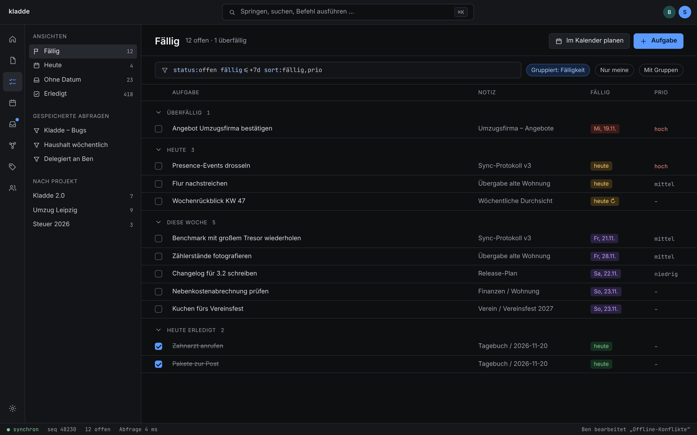
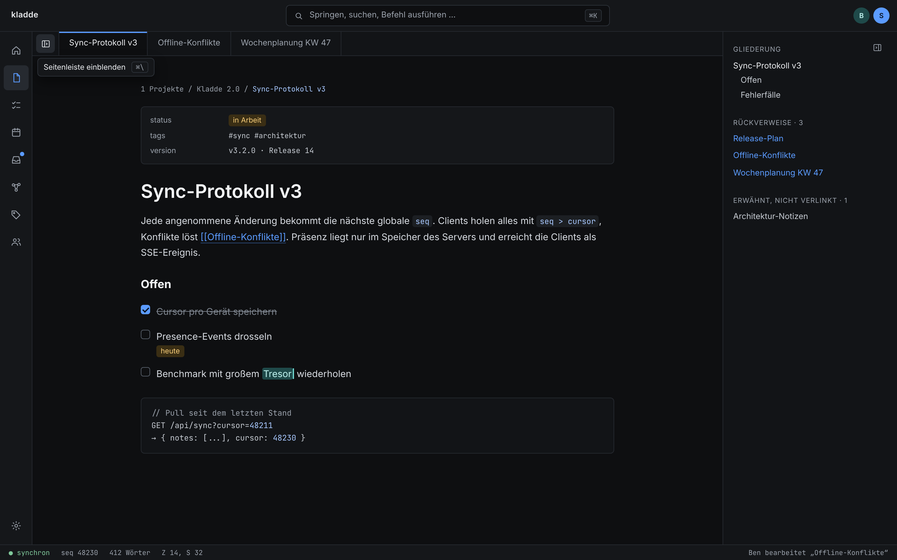

# Design: Werkbank

Werkbank ("workbench") is the planned design for Kladde. It will replace the Material 3 design described in rule 4
of [CLAUDE.md](../CLAUDE.md).

**Status: proposal.** Nothing in this document is implemented yet. The mockups below show the target; the migration
plan at the end lists the steps. Until it is merged, the Material 3 rules stay in force.


## Idea

Kladde is a tool for people with large vaults who write, link and plan every day. Werkbank treats it like that:

- **Dense, calm, dark.** Graphite surfaces, small type, thin lines instead of filled surfaces and shadows. Much of
  the vault fits on the screen at once.
- **One accent, chosen by each user.** The accent color marks what matters right now: the selection, the primary
  action, links, the user's own cursor. Everything else is grey. The default is blue; every user can pick another one
  (see [Accent color](#accent-color)).
- **Keyboard first.** ⌘K opens the command palette from everywhere; shortcuts are shown next to the commands
  (`<kbd>`), and every action has one.
- **State is visible.** A status bar shows sync, `seq`, word count and who else is working. Presence (avatars, remote
  cursors) appears where it happens.
- **Text is the product.** The editor gets a narrow, readable column (max. 760px) and the most contrast. Chrome steps
  back.

## Colors

The dark scheme is the default. All values are CSS variables on `:root` (later
`[data-theme='werkbank'][data-scheme='dark']`); Tailwind classes use the same names (`bg-panel`, `text-muted`).

### Surfaces and lines

| Token        | Value     | Use                                                        |
| ------------ | --------- | ---------------------------------------------------------- |
| `--bg`       | `#0E0F11` | Page, editor, main content                                 |
| `--panel`    | `#121417` | Side panels (tree, inspector), cards                       |
| `--bar`      | `#15171A` | Top bar, rail, status bar, phone bars, dialogs             |
| `--raised`   | `#1C1F23` | Buttons, inline code, inputs on panels                     |
| `--line`     | `#262A30` | Dividers, card borders, selected row in a list             |
| `--line2`    | `#2D3239` | Borders of controls (buttons, chips, search field, `kbd`)  |

### Text

| Token      | Value     | Contrast on `--bg` | Use                                              |
| ---------- | --------- | ------------------ | ------------------------------------------------ |
| `--strong` | `#F2F4F6` | 17.4 : 1           | Headings, note titles                            |
| `--text`   | `#E6E8EB` | 15.6 : 1           | Default text, list entries                       |
| `--body`   | `#D5D9DF` | 13.5 : 1           | Running text in the editor (a little softer)     |
| `--soft`   | `#C3C8CF` | 11.4 : 1           | Secondary entries in the tree                    |
| `--muted`  | `#9AA1AB` | 7.4 : 1            | Meta data, captions, icons, placeholders         |
| `--faint`  | `#7D848E` | 5.1 : 1            | Completed tasks (with line-through)              |

### Accent

The accent is a set of five tokens. Components only use these tokens, never a fixed accent value, so changing the
accent changes the whole interface at once.

| Token        | Default (blue) | Use                                                                      |
| ------------ | -------------- | ------------------------------------------------------------------------ |
| `--acc`      | `#5B9BFF`      | Active rail entry and icons, primary button, links, done checkboxes, own cursor and avatar, focus ring |
| `--acc-hi`   | `#A8C8FF`      | Text on `--acc-bg` (selected chips and segments), values in code         |
| `--acc-bg`   | `#14243D`      | Background of selected chips and segments                                |
| `--acc-line` | `#2D4E80`      | Underline of `[[links]]`, border of selected chips                       |
| `--on-acc`   | `#08111F`      | Text and icons on a filled accent (primary button, checkbox tick)        |

### Accent color

Every user picks an accent color in *Settings › Appearance*. The choice belongs to the **account** and follows the
user to all devices (unlike the color scheme, which stays per device). New accounts get **blue**.

There is a fixed set of presets instead of a free color picker, because every preset is checked for contrast in both
schemes:

| Preset            | `--acc`   | `--acc-hi` | `--acc-bg` | `--acc-line` | `--on-acc` | `--acc` on `--bg` | `--on-acc` on `--acc` |
| ----------------- | --------- | ---------- | ---------- | ------------ | ---------- | ----------------- | --------------------- |
| Blau (default)    | `#5B9BFF` | `#A8C8FF`  | `#14243D`  | `#2D4E80`    | `#08111F`  | 6.9 : 1           | 6.8 : 1               |
| Bernstein         | `#E8B04A` | `#F5CB78`  | `#3A2E14`  | `#6B5320`    | `#1A1408`  | 9.8 : 1           | 9.4 : 1               |
| Grün              | `#4FC385` | `#9BE3B8`  | `#12301F`  | `#2A5C3E`    | `#06170D`  | 8.7 : 1           | 8.3 : 1               |
| Türkis            | `#3EC1C4` | `#95E2E3`  | `#0F2E30`  | `#265B5D`    | `#041616`  | 8.8 : 1           | 8.5 : 1               |
| Violett           | `#A98BFF` | `#CDBDFF`  | `#241B3F`  | `#46387A`    | `#130C26`  | 7.1 : 1           | 7.1 : 1               |
| Rosa              | `#F27BB0` | `#F9B5D3`  | `#3A1729`  | `#6E2E4D`    | `#22081A`  | 7.5 : 1           | 7.4 : 1               |
| Koralle           | `#F2876B` | `#F8B9A7`  | `#3A1D15`  | `#6E3828`    | `#220C05`  | 7.7 : 1           | 7.5 : 1               |
| Graphit           | `#C3C8CF` | `#E6E8EB`  | `#262A30`  | `#4A5059`    | `#0E0F11`  | 11.4 : 1          | 11.4 : 1              |

`--acc-hi` on `--acc-bg` is at least 9.1 : 1 for every preset; `--acc` on `--line` (active rail entry) at least
5.2 : 1. The light scheme gets its own value set per preset (darker `--acc`, light `--acc-bg`).

How it works:

- The preset name is stored on the server with the account (e.g. `accent: 'blau'`), sent to the client with the
  session and cached locally, so the app starts in the right color offline and without a flash.
- The client sets `data-accent="blau"` on `<html>` (next to `data-scheme`); the token values live in CSS as
  `[data-accent='gruen'] { --acc: …; }` blocks for each scheme. No inline styles, so the strict CSP is untouched.
- The settings page shows the presets as round swatches with their name and a live preview (button, chip, link,
  checkbox, own avatar). Picking one applies it at once.
- Other people see you in your accent: avatar and cursor use your accent so you are recognizable in presence and
  shared notes. If two people share an accent, the second one shown gets a neutral ring around the avatar.

### States

State colors do **not** follow the accent. They mean the same thing for everyone. Every state has a foreground and a
dark background ("pill"); pairs are always used together.

| Token                       | Foreground | Background | Contrast | Use                                         |
| --------------------------- | ---------- | ---------- | -------- | ------------------------------------------- |
| `--amber` / `--amber-bg`    | `#F5CB78`  | `#3A2E14`  | 8.7 : 1  | Today, in progress, warnings                |
| `--red` / `--red-bg`        | `#F08A7E`  | `#3A1B18`  | 6.4 : 1  | Overdue, high priority, errors              |
| `--violet` / `--violet-bg`  | `#C3A6FF`  | `#2A2140`  | 7.4 : 1  | Planned dates, recurring tasks              |
| `--ok` / `--ok-bg`          | `#7FC79A`  | `#16301F`  | 7.1 : 1  | Done, synced, saved                         |

Rules:

- The accent appears **at most once or twice per area**: the active rail entry, one primary button, the selected tab.
  If everything is accented, nothing is.
- Colors that must be told apart also differ in lightness (red vs. green pills), never in hue alone.
- When the accent resembles a state color (Bernstein ≈ today, Grün ≈ done, Violett ≈ planned), state pills stay
  recognizable by their dark background and their label; accent elements never use the pill shape.
- PARA colors (graph, folder dots) are fixed too: projects amber `#E8B04A`, areas violet `#B49CFF`, resources green
  `#7FC79A`, archive grey `#6B727C`, journal pink `#F28FB8`. The selected node and its links use the accent.
- Presence: each person is shown in their own accent (see above); before their accent is known, a muted tone from a
  small fixed set (`#1F4A4A`, `#4B3B5E`, …).

## Typography

Two families, both self-hosted through `@fontsource` (the CSP allows no font CDN):

- **Inter** (variable) for the interface and text.
- **JetBrains Mono** for everything machine-like: counts, `seq`, dates in lists, tags, frontmatter values, queries,
  code, keyboard shortcuts, the status bar.

| Style       | Size / line height | Weight | Use                                              |
| ----------- | ------------------ | ------ | ------------------------------------------------ |
| `title-xl`  | 30 / 36            | 600    | Note title in the editor (26 on phones)          |
| `title-l`   | 20 / 28            | 600    | Page headings (Home, Tasks, Graph)               |
| `title-m`   | 18 / 26            | 600    | H2 in notes                                      |
| `body-l`    | 15 / 26 (1.7)      | 400    | Editor text (15.5 on phones)                     |
| `body-m`    | 13 / 20            | 400    | Interface default: lists, tree, buttons          |
| `body-s`    | 12 / 18            | 400    | Meta lines below list entries                    |
| `label`     | 11 / 16, +0.06em, uppercase | 400 | Section captions ("TODAY", "BACKLINKS")   |
| `mono-s`    | 11–12.5            | 400    | Numbers, tags, `kbd`, status bar                 |

Numbers in tables and counters use the mono font so columns line up.

## Shape, spacing, depth

- **Radii:** 4px (pills, `kbd`, tree rows), 6px (buttons, inputs, rail entries, tabs), 8px (cards), 10px (dialogs,
  command palette), 14px (phone FAB), full (chips, avatars).
- **Spacing:** 4px grid. Typical paddings: list rows 5×8 (tree) and 8×14 (cards), page headers 18×28, editor column
  36×40.
- **Lines, not shadows:** areas are separated by 1px `--line` borders. Shadows only for floating layers (command
  palette, menus, FAB): `0 24px 60px rgb(0 0 0 / .55)`. A modal dims the page with `rgb(5 6 8 / .62)`.
- **Motion:** short and functional (120–160ms ease-out for menus and the palette); no decorative animation;
  `prefers-reduced-motion` turns it off.

## Icons

Outline icons with round caps, 1.7px stroke at 18px (15px inside buttons and rows, 21px in the phone navigation bar),
colored `--muted` by default and `--acc` when active. We keep the pipeline from `lib/icons.tsx` /
`scripts/gen-icons.mjs` and switch to Material Symbols Rounded **outlined, weight 300**, which matches this look; no
filled icons.

## Layout

### Desktop (`nav:` screen and up)

```
┌──────────────────────── top bar: logo · command field (⌘K) · presence ────────────────────────┐
│rail│ side panel        │ main                                              │ inspector (opt.) │
│52px│ 240px, resizable  │ tabs / page header                                │ 280px            │
│    │ tree, views,      │ content (editor column max. 760px, centered)      │ outline,         │
│    │ saved queries     │                                                   │ backlinks, …     │
└──────────────────────── status bar: sync · seq · counts · activity of others ─────────────────┘
```

- **Top bar (48px):** logo, the command field in the middle (it is a button that opens the palette), avatars of the
  people online.
- **Rail (52px):** Home, Notes, Tasks, Calendar, Inbox (dot for new items), Graph, Tags, Groups; settings at the
  bottom. The active entry has `--line` background and an accent icon. Tooltips name every entry. The rail never
  collapses.
- **Side panel:** depends on the destination: the folder tree with pinned notes and groups (notes), views and saved
  queries (tasks), settings sections (settings), nothing (graph). Resizable with `ResizeHandle` and collapsible (see
  [Collapsible side panel](#collapsible-side-panel)).
- **Main:** a page header (title, short summary, actions on the right) or the tab row of open notes (active tab: accent
  line on top). Split view shows two editor columns side by side.
- **Inspector:** optional, per note: outline, backlinks, unlinked mentions, properties. Collapsible on its own with
  ⌘⇧\\ and the button in its header.
- **Status bar (24px, mono 11px):** `● synchron` in green (amber while syncing, red when offline), `seq`, counts that
  belong to the page, and on the right what others are doing ("Ben bearbeitet …").

### Collapsible side panel

The folder side panel can be collapsed so the editor gets the full width.

- **Toggle:** the button at the right end of the side panel's caption row (next to the note count), the shortcut **⌘\\**
  (Ctrl+\\ on Windows/Linux) and the command palette ("Seitenleiste ein-/ausblenden"). Dragging the `ResizeHandle`
  below 160px collapses it as well.
- **Collapsed:** the panel is gone completely; the rail stays. The tab row starts with a "show side panel" button
  (tooltip with the shortcut), and the editor shows the note's folder path as a mono breadcrumb above the properties.
  The editor column grows to max. 840px.
- **Reopening** restores the last width. Clicking the active Notes entry in the rail also toggles the panel.
- **Remembered per device** (like the width in `lib/sidebarWidth.ts`), because it depends on the screen.
- **Settings › Appearance › Side panel:** "start collapsed" (off by default), "collapse automatically below 1280px"
  (on by default; then the panel opens as an overlay over the editor and closes after a note is chosen), and whether
  the inspector is shown.
- Animation: width 160ms ease-out, none with `prefers-reduced-motion`. Focus moves to the toggle button when the
  panel closes and to the tree when it opens.
- On phones there is no side panel; the tree lives in the drawer as before.

### Phone (below `nav:`)

- **Top bar (60px):** menu (opens the drawer with the tree) or back, title, at most two actions (search, ⋮), presence
  avatar inside a note.
- **Bottom navigation bar:** Start, Notizen, Aufgaben, Eingang, Suche. The active destination is in the accent color
  with a short accent line above the icon; badges as on the rail.
- **FAB (56px, accent, 14px radius):** on lists for "new note"/"new task", bottom right above the navigation bar.
- **Editor:** no navigation bar. Instead a formatting bar (heading, bold, list, task, link, attachment, undo) above the
  keyboard and a mono status line (saved, words, who else is here). Properties collapse to one line (status pill and
  tags) and expand on tap.
- **Filters** are chips in a horizontally scrolling row below the top bar.
- Touch targets are at least 44×44px even where the drawing looks smaller.

## Components

| Component          | Look                                                                                         |
| ------------------ | -------------------------------------------------------------------------------------------- |
| Button             | 32px high, `--raised`, 1px `--line2`, 6px radius, icon 15px + label                          |
| Primary button     | `--acc` fill, text `--on-acc`, weight 600; one per view                                       |
| Icon button        | 40×40, transparent, `--muted` icon; `aria-label` always                                       |
| Chip               | 26px, full radius, 1px `--line2`; selected: `--acc-bg`, `--acc-line`, `--acc-hi`              |
| Pill               | 19px high, 4px radius, state foreground on state background (see colors)                      |
| Input / search     | 34px, `--bg` or `--panel`, 1px `--line2`, icon left, `kbd` hint right                         |
| Card               | `--panel`, 1px `--line`, 8px radius; header row with an uppercase `label` and a mono count    |
| List / tree row    | 5–11px vertical padding, selected: `--line` background, no extra border                       |
| Tab                | 38px, selected: `--bg` with a 2px `--acc` line on top, others `--muted`                       |
| Checkbox           | 15px, 1.5px `#59616C` border (3.1 : 1), done: `--acc` fill with `--on-acc` tick, text line-through |
| `kbd`              | mono 11px, 1px `--line2`, 4px radius, `--bar` background                                      |
| Properties         | Two-column grid in a `--bar` card: key in `--muted`, value as text, pill or mono              |
| Wiki link          | `--acc` text with a 1px `--acc-line` underline                                                |
| Inline code        | mono 12.5px, `--raised`, `--acc-hi`, no wrapping                                              |
| Command palette    | 640px, 110px from the top, `--bar`, 10px radius, shadow; input row with scope chips, grouped results (notes, tasks, commands) with icons and shortcuts, hint row at the bottom |
| Avatar             | 26px circle, initial in 11px/600, in the person's accent                                      |
| Segmented control  | 1px `--line2`, 6px radius; selected segment `--acc-bg` with `--acc-hi` text                  |
| Switch             | 36×20 track; on: `--acc` track with `--on-acc` knob, off: `--line2` track with `--muted` knob |
| Accent swatch      | 36px circle (44px on phones) with the name below; selected: 2px ring in the color and a tick  |

Dialogs keep the rules from CLAUDE.md (role, name, `useModal`).

## Screens

### Desktop

| | |
| --- | --- |
|  **Home:** today's tasks, inbox with "sort in", activity, recently edited |  **Tasks:** saved queries, query line, table grouped by due date |
|  **Command palette:** notes, tasks and commands in one list |  **Graph:** PARA colors, highlighted neighbours, inspector with filters and forces |
|  **Editor, side panel collapsed:** toggle in the tab row, breadcrumb, wider column |  **Settings › Appearance:** accent presets with preview, scheme, density, side panel |

### Phone

| | | | |
| --- | --- | --- | --- |
|  |  |  |  |
| Home | Notes | Editor with a remote cursor | Tasks |
|  | | | |
| Appearance (accent color) | | | |

## Accessibility

- All text pairs above reach WCAG AA (4.5 : 1) for every accent preset; most reach AAA. A new preset is only added
  after the same checks. Control borders that carry meaning (checkbox)
  reach 3 : 1; plain dividers (`--line`, `--line2`) are decoration and need not.
- Focus: a 2px `--acc` outline with 2px offset on every focusable element; never removed.
- The axe checks in `e2e/a11y.spec.ts` stay the gate for every screen and scheme.

## Open points

- **Light scheme.** Werkbank is designed dark first. A light scheme (paper-white surfaces, graphite text, darker state
  colors and a darker value set for every accent preset) has to be designed and checked before release; the `system`
  choice follows the OS as today.
- **`darker` tone.** Werkbank is already close to the old "darker" tone; it is probably dropped and mapped to dark.
- **Screens not drawn yet:** calendar, inbox triage, the other settings pages, admin, sharing and group dialogs, database view, split
  view, presentation mode.

## Migration plan

1. Add the tokens above to `client/src/index.css` under `data-theme="werkbank"` and expose them in
   `tailwind.config.js` (colors, the type scale, radii). Keep the Material roles as aliases for one release so
   existing views keep working.
2. Self-host Inter and JetBrains Mono through `@fontsource`; drop Roboto Flex.
3. Accent color: a numbered migration in `server/src/db.ts` that stores the preset per user (default `blau`), an API to
   read and change it, `data-accent` on `<html>` (set early by the inline theme script from the cached value, which
   needs a new CSP hash), the CSS blocks per preset and scheme, and the swatches in the settings.
4. Rebuild the components in `@layer components` (`.btn-*`, `.chip`, `.input`, `.card`, `.segmented`, `Switch`) and
   regenerate the icons with weight 300.
5. Replace `MaterialShell` with a Werkbank shell: top bar, rail, collapsible side panel (⌘\\, state per device next to
   `lib/sidebarWidth.ts`), inspector, status bar; on phones the top
   bar, bottom navigation bar, drawer and FAB. Keep the `nav:`, `phone:` and `tablet:` screens.
6. Add the command palette as the central entry (it can grow out of `SearchDialog`).
7. Move the views over one by one, remove the Material aliases, then update rule 4 in `CLAUDE.md` and the screenshots
   in `docs/images`.
8. Run the axe checks in all schemes, sizes and accent presets; record the results in `docs/ACCESSIBILITY.md`.
